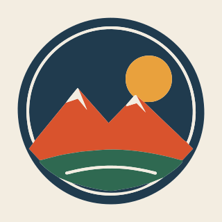

# Inlay



Trace images into vector shapes that fit together.

Inlay turns logos, illustrations, line art and pixel art into SVG. Every edge
between two colours is traced once and shared by both shapes, so they fit
together exactly, like inlaid wood: no gaps, no overlaps, no slivers when you
recolour, cut or print one colour at a time.

It comes two ways:

- **The app** traces an image in your browser, lets you check the result against
  the original, fix colours and shapes, and download SVG, PDF, EPS or PNG.
  Nothing is uploaded. **[Open the app](https://mattblack.space/tools/img-to-svg/)**
  (moving to inlaytrace.com).
- **The package**, [`inlaytrace`](https://www.npmjs.com/package/inlaytrace), is
  the tracer on its own: no dependencies and no WebAssembly, for browsers, Web
  Workers and Node 20+.

## Use the package

```bash
npm install inlaytrace
```

```ts
import { trace, toSvg, peakPalette } from 'inlaytrace'

// rgba: the image's pixels (a canvas's ImageData.data, or any RGBA bytes)
const result = trace(rgba, width, height, {
  mode: 'palette',
  palette: peakPalette(rgba, 8), // the image's main colours
  speckle: 8,
  tolerance: 1,
  cornerAngle: 45,
})

result.paths // [{ d, fill }, …], one per shape
toSvg(result) // '<svg …>'
```

[Getting started](docs/package/getting-started.md) ·
[Options](docs/package/options.md) · [API reference](docs/package/api.md)

## How it compares

On the app's sample badge, traced from a 640 px JPEG and rendered back at 4×
against the clean art ([how this is measured](docs/how-it-works/measuring-quality.md)):

| | Inlay | VTracer (cut-out shapes) |
| --- | --- | --- |
| Pixels wrong | **0.70%** | 0.85% |
| Nodes | **177** | 271 |
| Time for a 2048 px image¹ | **1.3 s** | 17.5 s |

¹ Timed by hand, one run each, when Inlay replaced VTracer
for the Logo preset ([design notes](docs/design-notes.md)); the other rows are
re-measured by `npm run site:assets`.

[VTracer](https://github.com/visioncortex/vtracer) is an excellent general
tracer, and the app still uses it for photos (the Poster preset). Inlay is
built for flat colour: straight edges stay single lines and corners stay sharp.
[Compared with other tools](docs/how-it-differs.md) covers Vectorizer.ai,
Vector Magic, Illustrator, Inkscape and SVGcode.

## Docs

- [What Inlay is](docs/overview.md)
- [How it works](docs/how-it-works.md): palettes, shared-edge tracing, curve
  fitting, measuring quality
- [The app](docs/features.md): every feature and how it works
- [Design notes](docs/design-notes.md): why things are the way they are, with
  the measurements
- [Roadmap](docs/roadmap.md) · [Research](docs/research.md)

## This repo

| Path | What |
| --- | --- |
| `packages/inlay` | The tracer, `inlaytrace` |
| `apps/app` | The app (React, Vite) |
| `apps/site` | The landing page and docs site (Astro, Starlight); the docs come from `docs/` |
| `docs` | The docs, as Markdown |
| `scripts` | Browser checks, quality scoring, hosting checks |

```bash
npm install
npm run dev     # the app: http://localhost:5173/tools/img-to-svg/
npm test
```

[CONTRIBUTING](CONTRIBUTING.md) has the rest: every command, how changes are
checked, and what to include in a bug report.

## Licence

MIT. VTracer is MIT OR Apache-2.0; SVGO, fflate and paper.js are MIT. Potrace
(GPL) and the `@imgly` packages (AGPL) are deliberately not used.
