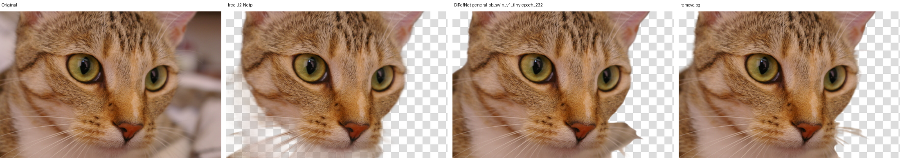
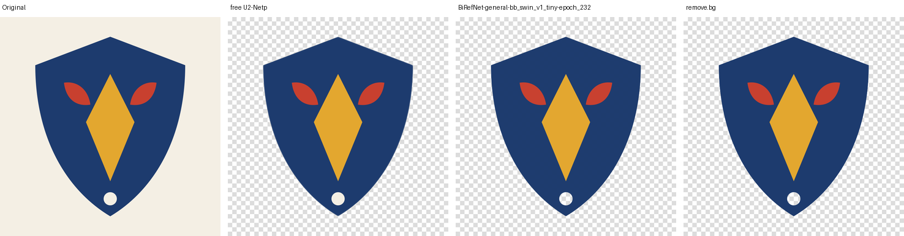
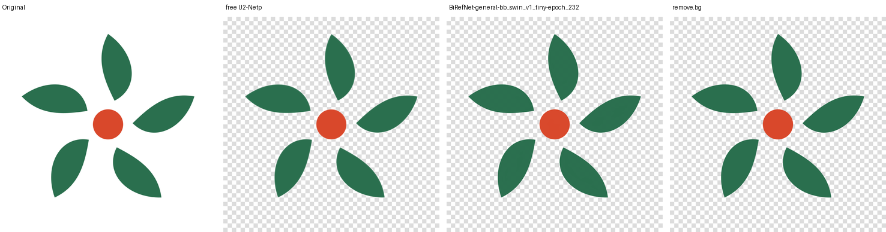
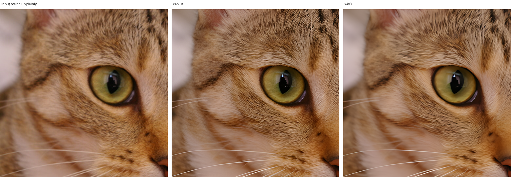
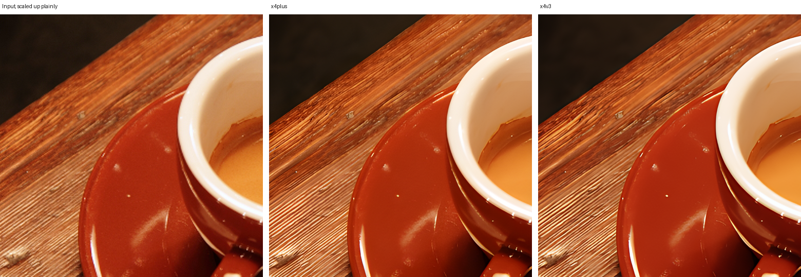

# HD models: report

Made by `scripts/hd-models/prepare.py` on a GitHub Actions runner (CPU only).

## Background removal: BiRefNet against remove.bg

Mask difference: the mean absolute difference between the two alpha masks, and the share of pixels on opposite sides of 50%.

| Image | Size | free U2-Netp time | free U2-Netp vs remove.bg | BiRefNet-general-bb_swin_v1_tiny-epoch_232 time | BiRefNet-general-bb_swin_v1_tiny-epoch_232 vs remove.bg |
| --- | --- | --- | --- | --- | --- |
| astronaut | 512 × 512 | 0.2 s | 2.57% / 2.06% | 4.5 s | 12.30% / 12.00% |
| coffee | 600 × 400 | 0.1 s | 0.57% / 0.18% | 4.6 s | 0.41% / 0.08% |
| chelsea | 451 × 300 | 0.1 s | 11.43% / 10.64% | 4.4 s | 2.17% / 1.61% |
| rocket | 640 × 427 | 0.1 s | 9.38% / 9.39% | 4.3 s | 5.47% / 3.75% |
| emblem | 800 × 800 | 0.1 s | 0.70% / 0.43% | 4.4 s | 0.26% / 0.00% |
| pinwheel | 800 × 800 | 0.1 s | 0.65% / 0.13% | 4.4 s | 0.26% / 0.02% |

### astronaut


### coffee


### chelsea



### rocket


### emblem



### pinwheel



## Upscaling: Real-ESRGAN x4plus (server) against general-x4v3 (in the browser today)

| Image | Input | x4plus time | x4v3 time |
| --- | --- | --- | --- |
| chelsea | 256 × 256 | 5.9 s | 0.4 s |
| coffee | 256 × 256 | 5.8 s | 0.4 s |

### chelsea



### coffee



## Models

```json
[
  {
    "file": "birefnet-BiRefNet-general-bb_swin_v1_tiny-epoch_232.onnx",
    "asset": "BiRefNet-general-bb_swin_v1_tiny-epoch_232.onnx",
    "source": "https://github.com/ZhengPeng7/BiRefNet/releases/download/v1/BiRefNet-general-bb_swin_v1_tiny-epoch_232.onnx",
    "licence": "MIT (BiRefNet)",
    "bytes": 224005088,
    "sha256": "5600024376f572a557870a5eb0afb1e5961636bef4e1e22132025467d0f03333"
  },
  {
    "file": "realesrgan-x4plus.onnx",
    "source": "https://github.com/xinntao/Real-ESRGAN/releases/download/v0.1.0/RealESRGAN_x4plus.pth (converted to ONNX, opset 17)",
    "licence": "BSD-3-Clause (Real-ESRGAN)",
    "bytes": 67051617,
    "sha256": "8028747b4d8d97a7d590e6f04762bb2e8fde87f734a70e1f7febf8201aeb30be"
  }
]
```

## Log

- BiRefNet ONNX assets: BiRefNet-COD-epoch_125.onnx (973 MB), BiRefNet-DIS-epoch_590.onnx (973 MB), BiRefNet-general-bb_swin_v1_tiny-epoch_232.onnx (224 MB), BiRefNet-general-epoch_244.onnx (973 MB), BiRefNet-general-resolution_512x512-fp16-epoch_216.onnx (941 MB), BiRefNet-HRSOD_DHU-epoch_115.onnx (973 MB), BiRefNet-massive-TR_DIS5K_TR_TEs-epoch_420.onnx (973 MB), BiRefNet-matting-epoch_100.onnx (973 MB), BiRefNet-portrait-epoch_150.onnx (973 MB), BiRefNet_HR-general-epoch_130.onnx (1099 MB), BiRefNet_HR-matting-epoch_135.onnx (1099 MB), BiRefNet_lite-general-2K-epoch_232.onnx (331 MB)
- Downloading https://github.com/ZhengPeng7/BiRefNet/releases/download/v1/BiRefNet-general-bb_swin_v1_tiny-epoch_232.onnx
- BiRefNet BiRefNet-general-bb_swin_v1_tiny-epoch_232.onnx: 224 MB, input [1, 3, 1024, 1024], outputs [[1, 1, 1024, 1024]]
- Downloading https://github.com/xinntao/Real-ESRGAN/releases/download/v0.1.0/RealESRGAN_x4plus.pth
